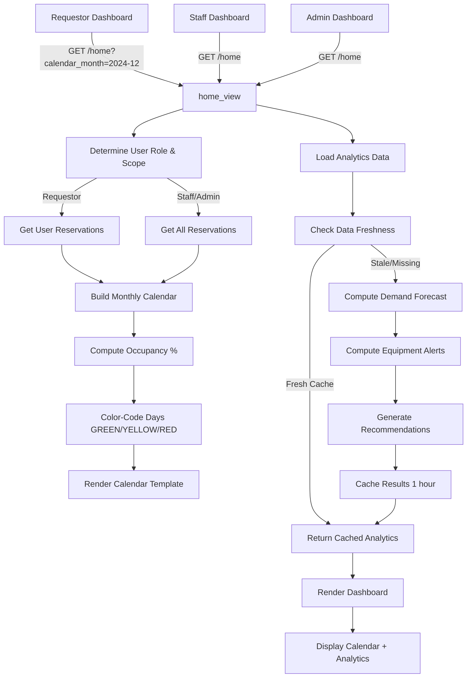

# Design Document: Facility Analytics, Enhanced Calendars & Predictive Analytics

## Overview

This design integrates four major components: facility booking calendar with color-coded availability, system-wide reservation calendar for admins/staff, predictive demand forecasting, and prescriptive recommendations. The architecture leverages Django ORM for efficient queries, cached analytics computation, and synthetic data for showcase.

## Architecture



## Data Flow

### 1. Facility Booking Calendar (Requestor View)

**Request**: GET `/book-facility/?facility_id=5&calendar_month=2024-12`

**Flow**:
- View queries reservations for facility 5, December 2024
- Computes occupancy for each day: `count(PENDING + APPROVED) / (total_time_slots_available)`
- Maps occupancy % to color:
  - 0-33% → GREEN
  - 34-66% → YELLOW
  - 67-100% → RED
- Builds calendar grid with color-coded days
- Attaches tooltip data (reservation times, requesters if visible)

**Database Queries**:
- SELECT * FROM reservations WHERE facility_id=5 AND reservation_date BETWEEN 2024-12-01 AND 2024-12-31 AND status IN ('PENDING', 'APPROVED') WITH select_related('requested_by')
- SELECT COUNT(*) FROM facilities.Facility WHERE id=5 (for total capacity/slots)

**Template Context**:
```python
{
  'facility': <Facility object>,
  'calendar_weeks': [
    [{
      'date': date(2024, 12, 1),
      'color': 'green',  # or 'yellow', 'red', 'gray'
      'occupancy_percent': 15,
      'reservation_count': 2,
      'reservations': [
        {'start_time': '09:00', 'end_time': '10:00', 'requester': 'John Doe'},
        ...
      ]
    }, ...],
    ...
  ]
}
```

### 2. System Reservations Calendar (Admin/Staff View)

**Request**: GET `/home/?calendar_month=2024-12` (for admin/staff)

**Flow**:
- View queries ALL reservations across all facilities for the month
- Groups by date (not by facility)
- Builds single calendar showing all bookings
- Each day cell shows a count or summary: "15 reservations"
- Clicking a day drills into detail view showing all reservations for that day

**Database Queries**:
- SELECT * FROM reservations WHERE reservation_date BETWEEN 2024-12-01 AND 2024-12-31 AND status IN ('PENDING', 'APPROVED') WITH select_related('facility', 'requested_by')
- SELECT COUNT DISTINCT(facility_id) FROM reservations ... (for summary stats)

**Template Context**:
```python
{
  'system_calendar_weeks': [
    [{
      'date': date(2024, 12, 1),
      'reservation_count': 5,
      'reservations_summary': '5 reservations across 3 facilities',
      'reservations_detail': [
        {
          'facility_name': 'ComLab 1',
          'time': '09:00-10:00',
          'requester': 'John Doe',
          'status': 'APPROVED'
        },
        ...
      ]
    }, ...],
    ...
  ]
}
```

### 3. Predictive Analytics Computation

**Trigger**: 
- On dashboard load (if cache is stale or missing)
- Runs async job daily (optional optimization)

**Algorithm**:

```python
def compute_predictive_analytics():
    """
    Analyze 6 months historical data, compute 3-month forecast.
    """
    
    # 1. Gather historical data
    six_months_ago = today() - timedelta(days=180)
    historical_res = Reservation.objects.filter(
        created_at__gte=six_months_ago,
        status__in=['APPROVED', 'COMPLETED']
    )
    
    # 2. Aggregate by month and facility
    monthly_by_facility = {}
    for res in historical_res:
        month_key = res.reservation_date.strftime('%Y-%m')
        fac_name = res.facility.name
        monthly_by_facility.setdefault((month_key, fac_name), []).append(res)
    
    # 3. Compute trend (linear regression or moving average)
    forecast = {}
    for (month, fac_name), reservations in monthly_by_facility.items():
        count = len(reservations)
        trend = compute_trend(historical_data[fac_name])  # Simple MA or regression
        forecast[(month, fac_name)] = {'historical': count, 'trend': trend}
    
    # 4. Extrapolate next 3 months
    next_3_months = compute_forecast(forecast, periods=3)
    
    return {
        'historical_monthly': monthly_data,
        'forecast_3_months': next_3_months,
        'peak_hours': compute_peak_hours(historical_res),
        'peak_days': compute_peak_days(historical_res),
    }
```

**Peak Hours Detection**:
```python
def compute_peak_hours(reservations):
    """Extract which hours have most bookings."""
    hour_counts = {}
    for res in reservations:
        hour = res.start_time.hour
        hour_counts[hour] = hour_counts.get(hour, 0) + 1
    # Return top 3 hours
    return sorted(hour_counts.items(), key=lambda x: x[1], reverse=True)[:3]
```

**Peak Days Detection**:
```python
def compute_peak_days(reservations):
    """Extract which days of week have most bookings."""
    day_counts = [0] * 7  # Mon-Sun
    for res in reservations:
        day_of_week = res.reservation_date.weekday()
        day_counts[day_of_week] += 1
    # Return days sorted by count
    days = ['Monday', 'Tuesday', ..., 'Sunday']
    return [(days[i], day_counts[i]) for i in range(7)]
```

**Caching**:
```python
ANALYTICS_CACHE_KEY = 'facility_analytics_dashboard'
ANALYTICS_CACHE_TTL = 3600  # 1 hour

def get_or_compute_analytics():
    cached = cache.get(ANALYTICS_CACHE_KEY)
    if cached:
        return cached
    
    analytics = compute_predictive_analytics()
    cache.set(ANALYTICS_CACHE_KEY, analytics, ANALYTICS_CACHE_TTL)
    return analytics
```

### 4. Prescriptive Recommendations Generation

**Algorithm**:

```python
def generate_recommendations(analytics_data):
    """
    Based on predictive analytics, generate actionable recommendations.
    """
    recommendations = []
    
    # 1. Maintenance timing
    low_occupancy_hours = analytics_data['peak_hours'][-3:]  # Off-peak
    if low_occupancy_hours:
        rec = {
            'priority': 'high',
            'title': 'Schedule maintenance during low-occupancy periods',
            'description': f"Recommended windows: {', '.join([f'{h}:00-{h+1}:00' for h, _ in low_occupancy_hours])}",
            'action': 'Create maintenance records for identified time slots',
            'impact': 'Minimize disruption to users'
        }
        recommendations.append(rec)
    
    # 2. Capacity planning
    high_occupancy_facilities = [
        fac for fac, occ_pct in analytics_data['occupancy_by_facility'].items()
        if occ_pct > 0.80
    ]
    if high_occupancy_facilities:
        rec = {
            'priority': 'high',
            'title': 'Consider capacity expansion',
            'description': f"{', '.join(high_occupancy_facilities)} exceed 80% occupancy.",
            'action': 'Review facility expansion options or stagger scheduling',
            'impact': 'Reduce booking conflicts'
        }
        recommendations.append(rec)
    
    # 3. Extended hours
    peak_days = analytics_data['peak_days'][:2]  # Top 2 busiest days
    if peak_days:
        days_str = ', '.join([day for day, _ in peak_days])
        rec = {
            'priority': 'medium',
            'title': 'Extend operating hours on peak days',
            'description': f"Peak demand on {days_str}. Consider extending availability.",
            'action': 'Review facility schedules and staff capacity',
            'impact': 'Better accommodate user demand'
        }
        recommendations.append(rec)
    
    # 4. Equipment maintenance alerts
    heavily_used_facilities = analytics_data['usage_intensity_by_facility']
    for fac_name, intensity in heavily_used_facilities:
        if intensity > 0.85:
            rec = {
                'priority': 'high',
                'title': f'Equipment maintenance alert for {fac_name}',
                'description': f"{fac_name} is used {intensity*100:.0f}% of operating hours.",
                'action': 'Schedule preventive maintenance checks',
                'impact': 'Prevent equipment failures and downtime'
            }
            recommendations.append(rec)
    
    return sorted(recommendations, key=lambda r: r['priority'] == 'high', reverse=True)
```

## Enhanced Facility Model

```python
class Facility(models.Model):
    # ... existing fields ...
    
    # NEW: Equipment & Details
    equipment_list = models.TextField(
        blank=True,
        default='',
        help_text='Comma-separated list of equipment (projector, whiteboard, A/C, etc.)'
    )
    hours_of_operation = models.CharField(
        max_length=200,
        blank=True,
        default='8am-6pm',
        help_text='e.g., "8am-6pm weekdays, 9am-5pm weekends"'
    )
    noise_level = models.CharField(
        max_length=20,
        choices=[('silent', 'Silent'), ('low', 'Low'), ('medium', 'Medium'), ('high', 'High')],
        blank=True,
        default='low',
        help_text='Noise level classification'
    )
    floor_number = models.IntegerField(
        blank=True,
        null=True,
        help_text='Floor number (e.g., 2 for 2nd floor)'
    )
    building_code = models.CharField(
        max_length=10,
        blank=True,
        default='',
        help_text='Building identifier (e.g., "ADMIN", "SCI")'
    )
    has_wheelchair_access = models.BooleanField(
        default=True,
        help_text='Wheelchair accessibility indicator'
    )
    # avg_reservation_duration is COMPUTED dynamically, not stored
    
    class Meta:
        # ... existing meta ...
        indexes = [
            # ... existing indexes ...
            models.Index(fields=['noise_level', 'capacity']),  # For amenity filtering
            models.Index(fields=['building_code', 'floor_number']),  # For location queries
        ]
```

## Mock Data Generation

**Command**: `python manage.py generate_analytics_data --months 6 --facilities 10`

```python
def generate_analytics_data(months=6, num_facilities=10):
    """
    Generate synthetic reservations with realistic patterns over N months.
    """
    today = timezone.localdate()
    start_date = today - timedelta(days=30*months)
    
    # 1. Get or create facilities
    facilities = Facility.objects.filter(is_synthetic=True)[:num_facilities]
    if facilities.count() < num_facilities:
        # Generate additional synthetic facilities
        for i in range(num_facilities - facilities.count()):
            fac = Facility.objects.create(
                name=f'Synthetic Lab {i+1}',
                location='Campus',
                capacity=30 + random.randint(0, 50),
                is_synthetic=True,
                equipment_list=random.choice([
                    'Projector, Whiteboard, A/C',
                    'Computers, Projector, Internet',
                    'Sound System, Projector, Lighting',
                    'Whiteboard, Markers',
                ])
            )
            facilities = list(facilities) + [fac]
    
    # 2. Generate reservations with realistic patterns
    current_date = start_date
    while current_date <= today:
        # 80% of bookings on weekdays (Mon-Fri), 20% on weekends
        if current_date.weekday() < 5:  # Weekday
            num_bookings = random.randint(3, 8)
        else:  # Weekend
            num_bookings = random.randint(0, 2)
        
        # Peak hours: 2-5pm
        for _ in range(num_bookings):
            facility = random.choice(facilities)
            
            # 70% chance for peak hours, 30% for other times
            if random.random() < 0.7:
                hour = random.randint(14, 16)  # 2-5pm
                minute = random.randint(0, 59)
            else:
                hour = random.choice([9, 10, 11, 15, 16, 17])
                minute = random.randint(0, 59)
            
            start_time = timezone.datetime.time(hour, minute)
            end_time = timezone.datetime.time(
                min(hour + random.randint(1, 3), 23),
                minute
            )
            
            requester = random.choice(User.objects.filter(role='REQUESTER'))
            reviewer = random.choice(User.objects.filter(role__in=['STAFF', 'ADMIN']))
            
            # 90% approved, 10% pending
            status = 'APPROVED' if random.random() < 0.9 else 'PENDING'
            
            Reservation.objects.create(
                requested_by=requester,
                facility=facility,
                purpose=f'Synthetic booking for {facility.name}',
                reservation_date=current_date,
                start_time=start_time,
                end_time=end_time,
                status=status,
                reviewed_by=reviewer if status == 'APPROVED' else None,
                reviewed_at=timezone.now() if status == 'APPROVED' else None,
                is_synthetic=True,
            )
        
        current_date += timedelta(days=1)
```

## Template Components

### 1. Facility Booking Calendar Fragment

```html


<div class="facility-booking-calendar">
  <h3>{{ facility.name }} - {{ calendar_month }}</h3>
  
  <div class="calendar-controls">
    <a href="?month={{ previous_month }}" class="btn btn-sm btn-outline-secondary">← Previous</a>
    <a href="?month={{ next_month }}" class="btn btn-sm btn-outline-secondary">Next →</a>
  </div>
  
  <table class="calendar-grid">
    <thead>
      <tr>
        <th>{{ day }}</th>
      </tr>
    </thead>
    <tbody>
      
        <tr>
          
            <td class="calendar-day color-{{ day.color }} today"
                data-date="{{ day.date }}"
                data-tooltip-trigger="hover">
              <div class="day-number">{{ day.date.day }}</div>
              <div class="day-occupancy">
                
                  <span class="occupancy-badge">{{ day.occupancy_percent }}%</span>
                  <span class="reservation-count">({{ day.reservation_count }})</span>
                
              </div>
              
              <div class="tooltip-content" style="display: none;">
                
                  <h5>{{ day.reservations|length }} Reservations</h5>
                  <ul>
                    
                      <li>
                        {{ res.start_time|time:"H:i" }}-{{ res.end_time|time:"H:i" }}
                        
                          ({{ res.requester }})
                        
                      </li>
                    
                  </ul>
                
                  <p>No reservations</p>
                
              </div>
            </td>
          
        </tr>
      
    </tbody>
  </table>
</div>

<style>
  .calendar-day.color-green { background-color: #d4edda; border: 1px solid #c3e6cb; }
  .calendar-day.color-yellow { background-color: #fff3cd; border: 1px solid #ffeaa7; }
  .calendar-day.color-red { background-color: #f8d7da; border: 1px solid #f5c6cb; }
  .calendar-day.color-gray { background-color: #e2e3e5; border: 1px solid #d3d6db; }
  .calendar-day:hover { cursor: pointer; box-shadow: 0 0 8px rgba(0,0,0,0.15); }
  .calendar-day.today { font-weight: bold; border: 2px solid #0066cc; }
  .occupancy-badge { font-weight: bold; font-size: 0.9em; }
  .reservation-count { font-size: 0.8em; color: #666; }
</style>

<script>
  document.querySelectorAll('.calendar-day[data-tooltip-trigger="hover"]').forEach(el => {
    el.addEventListener('mouseenter', function() {
      const tooltip = this.querySelector('.tooltip-content');
      if (tooltip) {
        tooltip.style.display = 'block';
        // Position tooltip below or above as needed
        tooltip.style.position = 'absolute';
        tooltip.style.zIndex = '1000';
        tooltip.style.backgroundColor = '#fff';
        tooltip.style.border = '1px solid #ccc';
        tooltip.style.borderRadius = '4px';
        tooltip.style.padding = '8px';
        tooltip.style.boxShadow = '0 2px 8px rgba(0,0,0,0.1)';
      }
    });
    el.addEventListener('mouseleave', function() {
      const tooltip = this.querySelector('.tooltip-content');
      if (tooltip) tooltip.style.display = 'none';
    });
  });
</script>
```

### 2. System Reservations Calendar Fragment

```html
<div class="system-reservations-calendar">
  <h3>All System Reservations - {{ calendar_month }}</h3>
  
  <table class="calendar-grid system-calendar">
    <thead>
      <tr>
        <th>{{ day }}</th>
      </tr>
    </thead>
    <tbody>
      
        <tr>
          
            <td class="calendar-day today" onclick="showReservationsModal('{{ day.date }}')">
              <div class="day-number">{{ day.date.day }}</div>
              <div class="reservation-summary">{{ day.reservation_count }} reservations</div>
            </td>
          
        </tr>
      
    </tbody>
  </table>
</div>

<!-- Modal for detailed view -->
<div class="modal" id="reservationsModal">
  <div class="modal-content">
    <span class="close">&times;</span>
    <h4 id="modalDate"></h4>
    <table class="table">
      <thead>
        <tr>
          <th>Time</th>
          <th>Facility</th>
          <th>Requester</th>
          <th>Status</th>
        </tr>
      </thead>
      <tbody id="modalReservations">
        <!-- Populated by JavaScript -->
      </tbody>
    </table>
  </div>
</div>

<script>
  function showReservationsModal(date) {
    const modal = document.getElementById('reservationsModal');
    document.getElementById('modalDate').textContent = 'Reservations for ' + date;
    // Fetch and populate reservations for this date
    // TODO: AJAX call to get_reservations_for_date endpoint
    modal.style.display = 'block';
  }
</script>
```

### 3. Analytics Dashboard Fragment

```html
<div class="analytics-dashboard">
  <div class="row">
    <!-- Demand Forecast Chart -->
    <div class="col-md-6">
      <div class="card">
        <div class="card-header">
          <h5>Demand Forecast (Next 3 Months)</h5>
        </div>
        <div class="card-body">
          <canvas id="demandForecastChart"></canvas>
          <script>
            // Chart.js: Display historical (solid) vs forecast (dashed) line
            const ctx = document.getElementById('demandForecastChart').getContext('2d');
            new Chart(ctx, {
              type: 'line',
              data: {
                labels: {{ chart_labels|safe }},
                datasets: [
                  {
                    label: 'Historical Demand',
                    data: {{ historical_data|safe }},
                    borderColor: '#0066cc',
                    fill: false,
                    tension: 0.3,
                  },
                  {
                    label: 'Forecast',
                    data: {{ forecast_data|safe }},
                    borderColor: '#28a745',
                    borderDash: [5, 5],
                    fill: false,
                    tension: 0.3,
                  }
                ]
              },
              options: { responsive: true, maintainAspectRatio: false }
            });
          </script>
        </div>
      </div>
    </div>
    
    <!-- Peak Hours Chart -->
    <div class="col-md-6">
      <div class="card">
        <div class="card-header">
          <h5>Peak Hours Analysis</h5>
        </div>
        <div class="card-body">
          <canvas id="peakHoursChart"></canvas>
          <!-- Bar chart showing bookings by hour -->
        </div>
      </div>
    </div>
  </div>
  
  <!-- Recommendations -->
  <div class="row mt-4">
    <div class="col-md-12">
      <div class="card">
        <div class="card-header">
          <h5>Recommended Actions</h5>
        </div>
        <div class="card-body">
          
            <div class="recommendation alert alert-dangeralert alert-warningalert alert-info">
              <h6>{{ rec.title }}</h6>
              <p>{{ rec.description }}</p>
              <small><strong>Action:</strong> {{ rec.action }}</small>
              <br>
              <small><strong>Impact:</strong> {{ rec.impact }}</small>
            </div>
          
        </div>
      </div>
    </div>
  </div>
</div>
```

## Database Indexes & Optimization

```python
# Ensure efficient analytics queries
class Reservation(models.Model):
    class Meta:
        indexes = [
            models.Index(fields=['facility', 'reservation_date', 'status']),
            models.Index(fields=['reservation_date', 'status']),
            models.Index(fields=['created_at']),  # For time-series analytics
        ]

class Facility(models.Model):
    class Meta:
        indexes = [
            models.Index(fields=['status']),
            models.Index(fields=['noise_level', 'capacity']),
            models.Index(fields=['building_code', 'floor_number']),
        ]
```

## Caching Strategy

- **Analytics Cache**: 1-hour TTL (recompute if data changes significantly)
- **Facility Details Cache**: 24-hour TTL (updated on facility edit)
- **Mock Data**: Cached separately, not invalidated unless explicitly regenerated

## Security & Permissions

- Requestors see only their own reservations in tooltips
- Staff/Admins see all reservations with requestor names
- Synthetic data clearly marked as such in UI

## Performance Targets

- Facility booking calendar load: < 500ms
- System reservations calendar load: < 1 second
- Analytics computation: < 5 seconds (async or cached)
- Dashboard render: < 2 seconds total
