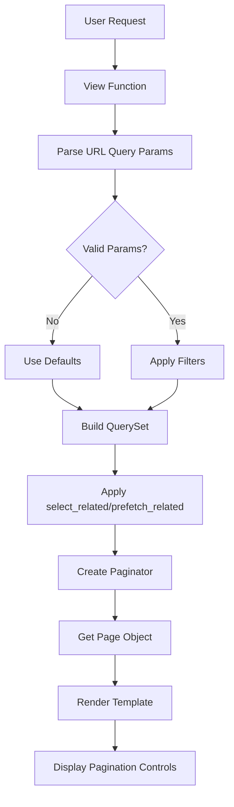

# Design Document: List Pagination and Filtering

## Overview

The DSSC CFRMS currently displays entire datasets on single pages, causing performance issues and poor UX when working with large record sets. This design introduces efficient pagination and filtering across reservation, facility, and maintenance list views using Django's built-in Paginator class, URL query parameters for state preservation, and database query optimization through select_related() and prefetch_related().

## Architecture



## Data Flow

1. **URL Query Parameters** → User provides ?page=2&status=PENDING&search=test
2. **View Function** → Parses params, validates, builds QuerySet
3. **Database Query** → Single optimized query with filters, select_related, and LIMIT/OFFSET
4. **Paginator** → Divides results into pages of 100 records
5. **Template Rendering** → Displays current page + pagination controls
6. **URL Preservation** → Pagination links include all existing filters

## Components and Interfaces

### 1. Pagination Utility Mixin

```python
class PaginationMixin:
    """Mixin for DRY pagination handling across all list views."""
    
    paginate_by = 100
    
    def get_page_context(self, queryset, page_number=None):
        """
        Generic pagination handler.
        
        Args:
            queryset: Django QuerySet to paginate
            page_number: Optional page number from request.GET
            
        Returns:
            dict with 'page', 'paginator', 'is_paginated', 'has_prev', 'has_next'
        """
        # Implementation details below
```

**Preconditions:**
- queryset must be a valid Django QuerySet (not a list)
- page_number is string from request.GET, may be invalid
- queryset must not already be sliced

**Postconditions:**
- Returns dict with 'page' and 'paginator' objects
- Invalid page_number defaults to page 1
- Page object contains page.object_list with correct slice of records

### 2. Filter Builder Utility

```python
class FilterBuilder:
    """Constructs complex QuerySet filters from request parameters."""
    
    def build_search_filter(self, search_term, search_fields):
        """
        Create Q() object for OR logic across multiple fields.
        
        Args:
            search_term: String to search for
            search_fields: List of model field names
            
        Returns:
            django.db.models.Q object
        """
        # Builds: Q(field1__icontains=term) | Q(field2__icontains=term) | ...
```

**Preconditions:**
- search_term is non-empty string
- search_fields is list of valid model field names
- All fields must exist on the model

**Postconditions:**
- Returns Q object representing OR logic
- Empty search_fields returns empty Q() object
- Search is case-insensitive (icontains)

### 3. Query Optimization Utilities

```python
class QueryOptimizer:
    """Applies select_related and prefetch_related to eliminate N+1 queries."""
    
    RESERVATION_OPTIMIZATIONS = {
        'select_related': ['facility', 'requested_by', 'reviewed_by'],
        'prefetch_related': []  # None needed for current structure
    }
    
    FACILITY_OPTIMIZATIONS = {
        'select_related': [],
        'prefetch_related': ['reservations']  # For aggregation queries
    }
    
    MAINTENANCE_OPTIMIZATIONS = {
        'select_related': ['facility'],
        'prefetch_related': []
    }
```

**Preconditions:**
- queryset is a valid Django QuerySet for the appropriate model
- Optimization dict keys match model relationships

**Postconditions:**
- Returns QuerySet with select_related/prefetch_related applied
- Does not slice or filter the QuerySet
- Same QuerySet object returned (chainable)

## Data Models and Filtering

### Reservation Filtering

**Search Fields:**
- reservation_date (YYYY-MM-DD format)
- facility.name (icontains)
- requested_by.get_full_name() (icontains)

**Filter Fields:**
- status: Exact match against Status.choices
- facility_id: Exact match against Facility.pk
- start_date: reservation_date >= start_date
- end_date: reservation_date <= end_date

**Search Logic:** Q(facility__name__icontains=search) | Q(reservation_date__icontains=search)

### Facility Filtering

**Search Fields:**
- name (icontains)
- building_name (icontains)

**Filter Fields:**
- status: Exact match against Status.choices

### Maintenance Filtering

**Search Fields:**
- facility.name (icontains)
- maintenance_date (YYYY-MM-DD format)

**Filter Fields:**
- status: Exact match against Status.choices

## View Implementation Pattern

```python
@login_required
@permission_required
def my_reservations_view(request):
    # 1. Base QuerySet with all records
    queryset = Reservation.objects.filter(requested_by=request.user)
    
    # 2. Apply optimizations
    queryset = QueryOptimizer.apply(queryset, 'RESERVATION_OPTIMIZATIONS')
    
    # 3. Parse and validate filters from URL
    status = request.GET.get('status', '')
    search_term = request.GET.get('search', '')
    page_number = request.GET.get('page', '1')
    
    # 4. Apply filters
    if status in dict(Reservation.Status.choices):
        queryset = queryset.filter(status=status)
    if search_term:
        queryset = queryset.filter(
            FilterBuilder.build_search_filter(
                search_term, 
                ['facility__name', 'reservation_date']
            )
        )
    
    # 5. Pagination
    paginator = Paginator(queryset, 100)
    page_obj = paginator.get_page(page_number)
    
    # 6. Context
    context = {
        'page_obj': page_obj,
        'paginator': paginator,
        'filters': {
            'status': status,
            'search': search_term,
        },
        'statuses': Reservation.Status.choices,
    }
    return render(request, template_name, context)
```

## Template Fragment: Pagination Controls

```html

<div class="pagination-container">
  <div class="pagination-info">
    Showing {{ page_obj.start_index }} to {{ page_obj.end_index }} 
    of {{ paginator.count }} total records
  </div>
  
  <nav aria-label="Pagination">
    <ul class="pagination">
      
        <li class="page-item">
          <a class="page-link" href="?page=1&{{ filter_params }}">First</a>
        </li>
        <li class="page-item">
          <a class="page-link" href="?page={{ page_obj.previous_page_number }}&{{ filter_params }}">Previous</a>
        </li>
      
      
      
        
          <li class="page-item active">
            <span class="page-link">{{ num }}</span>
          </li>
        
          <li class="page-item">
            <a class="page-link" href="?page={{ num }}&{{ filter_params }}">{{ num }}</a>
          </li>
        
      
      
      
        <li class="page-item">
          <a class="page-link" href="?page={{ page_obj.next_page_number }}&{{ filter_params }}">Next</a>
        </li>
        <li class="page-item">
          <a class="page-link" href="?page={{ paginator.num_pages }}&{{ filter_params }}">Last</a>
        </li>
      
    </ul>
  </nav>
</div>

```

## Template Fragment: Collapsible Filter Panel

```html
<div class="filter-section">
  <button class="btn btn-outline-secondary" type="button" data-toggle="collapse" 
          data-target="#filterPanel" id="filterToggle">
    <i class="fas fa-filter"></i> Filters
    <span class="badge badge-primary">{{ active_filters|length }}</span>
  </button>
  
  <div class="collapse show" id="filterPanel">
    <div class="filter-panel">
      <!-- Search Box -->
      <div class="form-group">
        <label for="searchInput">Search</label>
        <input type="text" class="form-control" id="searchInput" name="search" 
               value="{{ filters.search }}" placeholder="Search by ID, facility, date...">
      </div>
      
      <!-- Status Filter -->
      <div class="form-group">
        <label for="statusSelect">Status</label>
        <select class="form-control" id="statusSelect" name="status">
          <option value="">All Statuses</option>
          
            <option value="{{ value }}" selected>
              {{ label }}
            </option>
          
        </select>
      </div>
      
      <!-- Date Range (if applicable) -->
      <div class="form-row">
        <div class="form-group col-md-6">
          <label for="startDate">Start Date</label>
          <input type="date" class="form-control" id="startDate" name="start_date" 
                 value="{{ filters.start_date }}">
        </div>
        <div class="form-group col-md-6">
          <label for="endDate">End Date</label>
          <input type="date" class="form-control" id="endDate" name="end_date" 
                 value="{{ filters.end_date }}">
        </div>
      </div>
      
      <!-- Filter Buttons -->
      <div class="button-group">
        <button type="submit" class="btn btn-primary">Apply Filters</button>
        <a href="" class="btn btn-secondary">Clear All</a>
      </div>
    </div>
  </div>
</div>
```

## Filter State Preservation

### URL Parameter Format

All filter state is stored in URL query parameters:
```
/reservations/my_reservations/?page=2&status=PENDING&search=test&start_date=2024-01-01
```

### Template Helper: Build Filter Params

```django
?page={{ page_num }}&status={{ filters.status }}&search={{ filters.search }}
```

Or in views:

```python
from urllib.parse import urlencode

filter_params = urlencode({
    k: v for k, v in {
        'status': request.GET.get('status', ''),
        'search': request.GET.get('search', ''),
        'start_date': request.GET.get('start_date', ''),
    }.items() if v
})

context['filter_params'] = filter_params
```

## Database Query Optimization Strategy

### 1. Query Optimization Checklist

✓ **Use LIMIT/OFFSET via Paginator**: Only fetch current page from database
✓ **select_related() for FK**: Eliminate N+1 for facility, requested_by, reviewed_by
✓ **No prefetch_related for now**: Current queries don't need reverse relationships
✓ **Index Strategy**: Leverage existing indexes on (facility, reservation_date, status)
✓ **Count Optimization**: Single Count aggregate query with filters

### 2. Example Optimized Query (from db.connections.queries)

```sql
-- BEFORE (N+1 problem):
SELECT * FROM reservation WHERE requested_by_id = 1;  -- 1 query
SELECT * FROM facility WHERE id = X;  -- N queries, one per reservation

-- AFTER (Optimized):
SELECT res.*, fac.* FROM reservation res
LEFT JOIN facility fac ON res.facility_id = fac.id
WHERE res.requested_by_id = 1
LIMIT 100 OFFSET 200;  -- 1 query fetches both
```

### 3. Performance SLA Targets

- List page with 0 filters: **< 200ms** (cached queries)
- List page with 3 filters: **< 500ms** (index-assisted queries)
- Search with term: **< 1000ms** (full-text search would be needed for better performance)
- Pagination link click: **< 300ms** (cache warm)

## Edge Case Handling

### 1. Invalid Page Numbers

```python
# Django's Paginator.get_page() handles gracefully:
paginator = Paginator(queryset, 100)
page_obj = paginator.get_page(999)  # Returns last page, no error
page_obj = paginator.get_page('invalid')  # Returns page 1
```

### 2. Empty Search Results

```html

  <div class="alert alert-info">
    No records match your search criteria. 
    <a href="">Clear filters</a>
  </div>

```

### 3. Invalid Filter Parameters

```python
status = request.GET.get('status', '')
# Validate before using
if status and status not in dict(Reservation.Status.choices):
    status = ''  # Ignore invalid status
```

### 4. Clearing Filters

```html
<a href="" class="btn btn-secondary">Clear All Filters</a>
```

This resets to default view without any query parameters.

## Testing Strategy

### Unit Tests for Utilities

**PaginationMixin Tests:**
- Test page_context with valid page numbers
- Test default to page 1 on invalid input
- Test preservation of queryset size
- Test has_previous/has_next flags
- Test start_index/end_index calculations

**FilterBuilder Tests:**
- Test Q object generation for single field
- Test Q object generation for multiple fields (OR logic)
- Test empty search term handling
- Test special characters in search (SQL injection prevention)

**QueryOptimizer Tests:**
- Test select_related applied correctly
- Test querycount (verify N+1 eliminated)
- Test prefetch_related applied correctly

### Integration Tests

**View Integration Tests:**
- Test my_reservations_view with pagination
- Test filter preservation across page nav
- Test search functionality
- Test combination of status + date + search filters
- Test invalid page number redirects to page 1

**Template Tests:**
- Test pagination controls render
- Test filter panel toggle
- Test active filter badge display
- Test filter params in pagination links

### Property-Based Tests

Since this feature involves data transformation and filtering, property-based testing can verify universal properties:

**Property 1: Pagination Preserves All Records**
- *For any* valid queryset and page size, paginating and concatenating all pages should equal the complete queryset

**Property 2: Filter Logic Correctness**
- *For any* status value, filtering by status should return only records matching that status

**Property 3: Search Consistency**
- *For any* search term, searching then searching again should yield identical results (idempotence)

**Property 4: URL State Round-Trip**
- *For any* set of filters, encoding to URL params then decoding should restore original filter state

**Property 5: Query Optimization**
- *For any* paginated view, the query count should be exactly 2 (one for paginator.count, one for page fetch), not N+1

## Correctness Properties

*A property is a characteristic or behavior that should hold true across all valid executions of a system—essentially, a formal statement about what the system should do.*

### Property 1: Pagination Preserves Record Ordering

For any valid QuerySet and page size, concatenating all pages in order should reproduce the same QuerySet when ordered identically.

**Validates: Requirements 1.1, 1.2, 1.3, 2.1, 3.1**

### Property 2: Filters Reduce or Maintain Record Count

For any filter applied to a QuerySet, the filtered result count should be less than or equal to the unfiltered count.

**Validates: Requirements 4.1, 5.1, 6.1, 7.1**

### Property 3: Search Term Matching is Consistent

For any search term and field, searching multiple times with the same term should always return the same records in the same order.

**Validates: Requirements 4.2, 4.3, 15.2**

### Property 4: Filter State URL Preservation

For any set of applied filters, encoding filters to URL query parameters and then parsing them back should restore all original filter values.

**Validates: Requirements 6.2, 9.1, 9.2, 9.3, 9.4**

### Property 5: Invalid Page Numbers Handled Gracefully

For any invalid page number (negative, zero, or beyond max), the system should return either page 1 or the last available page, never an error.

**Validates: Requirements 13.1**

### Property 6: Query Count Remains Bounded

For any paginated list view, the number of database queries should not exceed 3 (count query, page fetch, any aggregation), regardless of dataset size.

**Validates: Requirement 10.2, 10.3, 12.1, 12.2**

### Property 7: Search Results in Page Reset

For any previously selected page number, applying a new search term should reset pagination to page 1.

**Validates: Requirement 4.6, 15.3**

### Property 8: Empty Results Display Clearly

For any search or filter combination that yields zero matching records, the system should display a message, never an empty blank page.

**Validates: Requirements 4.7, 13.2**

## Performance Considerations

### Query Optimization Priorities

1. **Index Strategy**: Existing index on (facility, reservation_date, status) supports most queries
2. **select_related()**: Eliminate N+1 on FK relationships (facility, requested_by, reviewed_by)
3. **Pagination**: Fetch only current page via LIMIT/OFFSET, not all records
4. **Count Query**: Single Count aggregate query with applied filters

### Caching Strategy

- **Page Cache**: None (data changes frequently via approvals/rejections)
- **Query Result Cache**: None (assume fresh data on every request)
- **Aggregate Caches**: Optional—cache total record counts for 5 minutes if performance issues arise

### Load Testing Scenarios

- **Scenario 1**: 10,000 reservations, 100 per page, no filters → < 1 sec
- **Scenario 2**: 10,000 reservations, page 50, status filter applied → < 1 sec
- **Scenario 3**: 10,000 reservations, search term matching 500 records → < 1.5 sec

## Security Considerations

### Permission Isolation

- **my_reservations_view**: Decorated with @requester_required, hard-filtered to request.user
- **pending_reservations_view**: Decorated with @reservation_reviewer_required, shows student requests only
- **reservation_report_view**: Decorated with @reservation_reviewer_required

No URL/query parameter can override these hard filters.

### Input Validation

- **Page number**: Validated via Paginator.get_page(), defaults to 1 on invalid input
- **Status values**: Validated against Reservation.Status.choices before filtering
- **Date values**: Parsed via parse_date(), invalid dates ignored
- **Search term**: Used in Q(field__icontains=value) which is parameterized

### SQL Injection Prevention

All ORM queries use parameterized lookups:
```python
# Safe: uses parameter binding
queryset.filter(status=status)  # ✓
queryset.filter(Q(facility__name__icontains=search_term))  # ✓

# Unsafe: raw SQL (not used in this design)
# Reservation.objects.raw(f"SELECT * FROM res WHERE status = '{status}'")  # ✗
```

## Dependencies

- **Django Paginator**: django.core.paginator.Paginator (built-in)
- **Q Objects**: django.db.models.Q (built-in)
- **Decorators**: @login_required, @requester_required, @reservation_reviewer_required (existing)
- **Bootstrap**: 5.x for pagination and filter UI components
- **JavaScript**: data-toggle="collapse" (Bootstrap native, no additional dependency)

## Implementation Notes

1. **Page Size**: Fixed at 100 records per page across all views
2. **Default Filters**: Each view has sensible defaults (e.g., pending_reservations defaults to PENDING status)
3. **State Storage**: All state in URL query parameters, no sessions for filter state
4. **Mobile Friendly**: Filter panel collapses on small screens via Bootstrap
5. **Accessibility**: Pagination uses semantic HTML `<nav>` and ARIA labels
6. **Performance First**: Database queries optimized before any caching layer added
